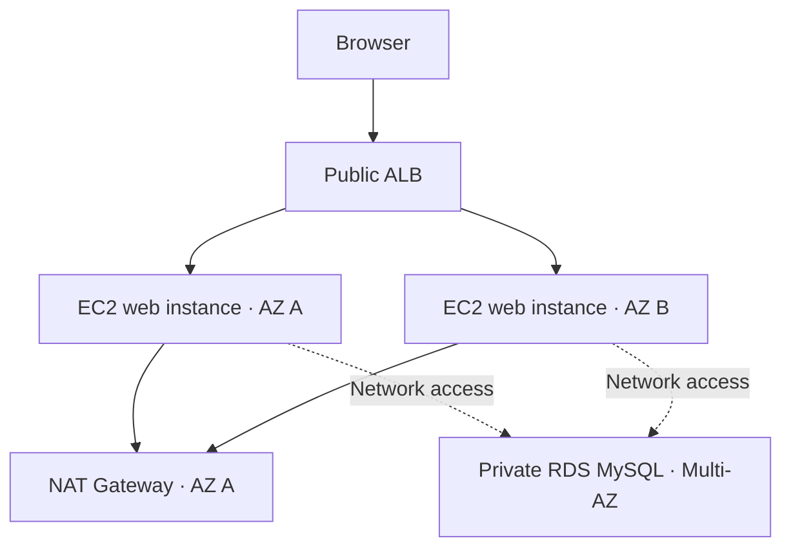

# Scalable Web App on AWS with Terraform

A portfolio infrastructure project that deploys a small, load-balanced web tier across two Availability Zones. Terraform provisions the network, an Application Load Balancer (ALB), an EC2 Auto Scaling group, a private Multi-AZ MySQL database, and an encrypted S3 bucket. The current web page is an Apache demonstration page; database queries and S3 asset handling are integration work for a future application.

## Architecture



| Tier | Placement | Purpose |
| --- | --- | --- |
| Public | Two subnets in separate AZs | Internet-facing ALB; NAT Gateway in the first AZ |
| Application | Two private subnets | Auto Scaling EC2 instances running Apache; no public IPs |
| Database | Two isolated private subnets | RDS MySQL Multi-AZ; no public route or public endpoint |

The ALB forwards HTTP requests to healthy EC2 instances. The web security group accepts port 80 only from the ALB security group. The database security group accepts MySQL port 3306 only from the web security group. Private application instances use the NAT Gateway for outbound package installation and Systems Manager connectivity. The database subnets have no default route to the internet. The VPC's default network ACL is used; the security groups provide the traffic restrictions.

With no certificate configured, the ALB serves HTTP on port 80. Supplying an issued ACM certificate ARN enables an HTTPS listener on port 443 and redirects port 80 to HTTPS. HTTPS also requires a domain that matches the certificate and DNS configured to point to the ALB; the ALB's own DNS name will not match your certificate.

## AWS services and Terraform resources

| Service | Implementation |
| --- | --- |
| VPC | Six subnets across two AZs, route tables, internet gateway, and one NAT Gateway |
| Elastic Load Balancing | Public ALB, HTTP health checks, target group, and optional HTTPS listener |
| EC2 and Auto Scaling | Amazon Linux 2023 launch template, two initial instances, capacity range of two to four, CPU target tracking at 50%, and rolling instance refresh |
| RDS and Secrets Manager | MySQL 8.4 Multi-AZ instance, private DB subnet group, seven-day backup retention, and an RDS-managed master password |
| S3 and KMS | Private versioned assets bucket with public access blocked and SSE-KMS encryption; KMS encryption for RDS storage |
| IAM and Systems Manager | EC2 instance role scoped to the assets bucket, encryption key, and RDS-managed secret; Systems Manager managed instance policy; no project IAM access keys |

The EC2 bootstrap installs Apache and creates a static HTML page. IAM and networking permit a future app to access S3 and retrieve the RDS secret, but this demonstration page does **not** read from either service. A successful ALB response alone therefore does not verify database or S3 functionality.

## Project files

| File | Role |
| --- | --- |
| `provider.tf` | Terraform version, AWS and random providers, region, and default tags |
| `variables.tf` | Region, network CIDRs, instance choices, project naming, and optional ACM certificate |
| `main.tf` | AWS infrastructure and EC2 bootstrap |
| `outputs.tf` | ALB, Auto Scaling, bucket, database endpoint, and secret ARN outputs |

## Terraform workflow

1. Install Terraform 1.6 or newer and the AWS CLI. Configure AWS credentials with permissions to create the listed resources. An AWS CLI profile or IAM Identity Center session avoids storing long-lived credentials in this repository.
2. In the directory containing the four `.tf` files, check the identity and region. The default region is `us-east-1`; set `TF_VAR_region` if deploying elsewhere.
3. Initialize providers, format and validate the files, then inspect a saved plan before applying:

```bash
aws sts get-caller-identity
terraform init
terraform fmt
terraform validate
terraform plan -out=tfplan
terraform apply tfplan
```

4. Get the application URL and infrastructure identifiers:

```bash
terraform output
terraform output -raw alb_dns_name
```

`web_url` provides the HTTP URL when `certificate_arn` is unset. With HTTPS enabled, use the custom domain matching the certificate. Example optional settings can be supplied as environment variables:

```bash
export TF_VAR_region="us-east-1"
export TF_VAR_project_name="webapp"
# Set only after the ACM certificate and matching DNS name are ready:
# export TF_VAR_certificate_arn="arn:aws:acm:us-east-1:ACCOUNT_ID:certificate/CERTIFICATE_ID"
```

Before running another `apply`, run `terraform plan` again and inspect any changes. To clean up the demonstration:

```bash
terraform destroy
```

Versioned S3 objects must be emptied before Terraform can remove a nonempty assets bucket. The KMS key is scheduled for deletion rather than disappearing immediately.

**State and repository hygiene:** This version uses Terraform's local state. For a shared or longer-lived project, bootstrap a separate encrypted, versioned S3 backend with state locking and migrate state before collaborating. Do not commit `.terraform/`, `terraform.tfstate*`, `tfplan`, private keys, or variable files containing secrets. Commit `.terraform.lock.hcl` after `terraform init` so provider selections are reproducible.

## Initial problems found and improvements made

| Initial configuration | Improvement in this version |
| --- | --- |
| The same custom, stateless NACL allowed only inbound 80/443 on public and private subnets, blocking return and database traffic. | Removed the custom NACL and retained security-group rules for ALB → web and web → RDS access. |
| EC2 instances ran in public subnets. | Moved them to private application subnets; only the ALB and NAT Gateway are public. |
| App and DB shared one private subnet tier. | Added two separate database subnets with no internet default route. |
| The Auto Scaling group had minimum and maximum sizes but no scaling policy. | Added CPU target tracking, load-balancer health checks, warm-up, and rolling instance refresh. |
| An IAM user and access key were created by Terraform with broad permissions. | Removed them; instances use an IAM role and deployment credentials come from the operator's AWS configuration. |
| The broad IAM user policy included the invalid `vpc:*` action. | Removed that policy with the IAM user; the deploying identity must have the necessary EC2 permissions for VPC resources. |
| A database password was hard-coded in Terraform. | RDS now generates and manages the master password in Secrets Manager; the output exposes only the secret ARN. |
| The AMI lookup selected Amazon Linux 2 and user data installed a minimal placeholder. | Uses the current Amazon Linux 2023 AMI parameter and an Apache bootstrap suited to this infrastructure demo. |
| RDS used MySQL 8.0. | Uses MySQL 8.4, with Multi-AZ, gp3 storage, storage autoscaling, and backups. |
| EC2 had S3 permissions but lacked permissions for objects encrypted with the customer-managed KMS key. | Added KMS decrypt and data-key permissions scoped to the project's key. |
| Port 443 was open without an HTTPS listener. | Port 443 opens only if a certificate ARN is set; the HTTP listener then redirects to HTTPS. |
| The S3 bucket had no versioning. | Enabled versioning alongside public access blocking and SSE-KMS. |

The instance-refresh warning encountered during validation was resolved by removing the redundant `triggers = ["launch_template"]` line. Changes to the launch template version already trigger a refresh through the Auto Scaling group's `instance_refresh` configuration.

## Resiliency checks and scope

The deployed URL can be checked with `curl` and the ALB target group's health view. To exercise instance replacement, monitor the URL while terminating **one** instance through the Auto Scaling Group without decrementing desired capacity. The expected result is continued HTTP responses and a new healthy instance bringing the group back to two. This tests a single web-instance failure; record the observed response codes and recovery time if repeating the test for a portfolio write-up.

This demonstration does not test a complete AZ outage. Its one NAT Gateway sits in the first AZ, so private instances in the second AZ depend on it for outbound access. It also does not test RDS failover or database-backed application requests because the served HTML page does not use MySQL. The default deployment is HTTP until an ACM certificate and DNS are configured. There is no remote Terraform backend or custom CloudWatch alarm in these four files.

The configuration creates billable infrastructure, including an ALB, NAT Gateway, running EC2 instances, a Multi-AZ RDS instance, and a KMS key. Review the plan and AWS billing before leaving the demo running.
